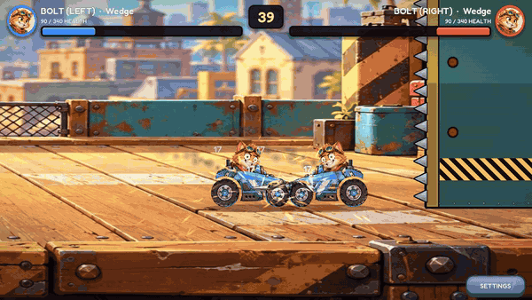
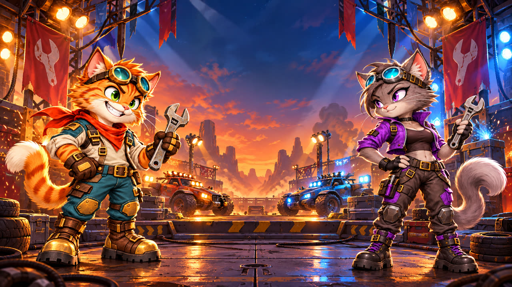

# DATS

**A 2D physics battle game for Android, built in Godot 4.** Players build a fighting car from parts in a garage, pick one of six cat drivers, and send it into a 45-second automatic battle against another player's build.



## Videos

▶️ **[Game walkthrough (1 min 16 s)](media/dats-walkthrough.mp4).** This follows the full player flow: studio splash, sign-in screen, hub, choosing a driver, buying parts in the marketplace, building the car in the garage, then two practice fights with different loadouts.

▶️ **[More battles (1 min 42 s, with sound)](media/dats-gameplay.mp4).** This was recorded directly from the game using Godot's Movie Maker mode. It shows several different match-ups, then a full fight ending on the result screen.



## About this repository

DATS is in private beta (v0.5.0) on Android. This repository is a **showcase of the gameplay code**. It contains the game's core systems and automated checks. The art, audio, project files, online backend and deployment setup are kept private, so the code here isn't a runnable build.

## Gameplay

- **Garage building.** Drag parts onto a chassis: weapons go on hexagonal mounts, defences and gadgets on square mounts, and two wheels are required. Each chassis has an energy budget and a tier, so overloaded or under-tier builds can't fight.
- **Physics battles.** Two cars drive at each other and fight with melee weapons, projectiles and gadgets. From 12 seconds, spiked crusher walls close in, and any car part touching a spike is destroyed.
- **Damage model.** Every part has its own health. Parts break off individually, and the car is defeated when its total health reaches zero.
- **Drivers.** Six cat drivers (Bolt, Nova, Tank, Patch, Dash and Spark) react to damage with changing expressions. On defeat, the driver ejects and parachutes to the floor.
- **Progression.** Players earn XP and gold, unlock part tiers, buy supply boxes and part copies in the marketplace, and fuse spare parts to upgrade them.
- **Online play (private).** Friend battles with username invites and reusable lobbies, backed by a hosted database and a server-side battle worker.

## Code tour

| Path | What it covers |
|---|---|
| `game/scripts/battle.gd` | Arena, fight loop, crusher walls, damage events, camera, HUD and the end-of-fight summary |
| `game/scripts/car.gd` | Car physics, suspension, part mounting, weapon and gadget behaviour, and part-level damage |
| `game/scripts/parts.gd`, `catalogue.gd` | Part definitions, mount rules, tier ratings and the energy report |
| `game/scripts/inventory.gd`, `progression.gd` | Collected items, build validation, rewards, levelling and fusion |
| `game/scripts/garage_*.gd`, `swipe_parts_shelf.gd` | The drag-and-drop garage: sockets, placement previews and the parts shelf |
| `game/scripts/driver_*.gd`, `parachute_escape.gd` | Driver animation, expressions and the ejection sequence |
| `game/scripts/main.gd` | Scene flow between the launch screen, hub, garage and battle |
| `game/tools/*_checks.gd` | 15 automated check suites |
| `docs/game-design-notes.md` | Garage, energy, tier and combat rules |

## Testing

The `game/tools` suites run headless in Godot and print a PASS or FAIL line for each check. They cover combat, movement, mounts, equipment, tiers, progression, the economy client, gadgets, the catalogue, controls, balance, the launch flow and menu visuals. In the full project, the combat suite alone runs 91 checks. For example:

```bash
godot --headless --path game --script res://tools/combat_checks.gd
```

The game also has an `--autotest` mode that plays a fixed list of match-ups and logs who won, how and when. That mode was used to record the gameplay video.

## Tech

Godot 4.7, GDScript and the GL Compatibility renderer, targeting Android. Online play uses a hosted Postgres backend with row-level security and a containerised battle worker, both kept in the private repository.

## Licence

Copyright © 2026 Adeolu Idowu. All rights reserved. The source is published so it can be viewed. No licence is granted to copy, modify or redistribute it.
